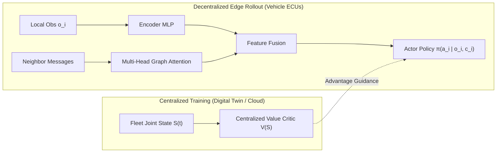

# Distributed Cooperative Driving for Autonomous Logistics Fleets
## Graph-Attentive Multi-Agent Reinforcement Learning for Bottleneck Scheduling
**Course:** Distributed Analytics for Industrial Automation  
**Department:** Industrial and Systems Engineering (ISE)  
**Author:** dhanvithnayak  

---

## Slide 1: Title & Academic Context
### Distributed Automated Driving for Cyber-Physical Logistics Networks
* **Domain:** Industrial and Systems Engineering (ISE) & Automated Manufacturing Logistics
* **Focus Area:** Distributed Edge Analytics, Multi-Agent Coordination, Cyber-Physical Systems
* **Core Technology:** Graph Attention Networks (GAT) + Centralized Training with Decentralized Execution (CTDE)

> **Speaker Notes:**
> "Good morning everyone. Today, I am presenting our course project for Distributed Analytics for Industrial Automation. In this work, we address the critical bottleneck problem in industrial logistics corridors and freight yards by developing a distributed automated driving system using multi-agent reinforcement learning. We leverage dynamic vehicle-to-vehicle communication graphs to optimize throughput, prevent deadlocks, and guarantee safety under real-world cyber-physical network constraints."

---

## Slide 2: The Industrial Bottleneck Dilemma
### Why Centralized & Classical Systems Fail in Modern Automation

| Traditional Centralized Dispatch | Classical Heuristics (FIFO / TTC) | Distributed Multi-Agent RL (Proposed) |
| :--- | :--- | :--- |
| **Computational Explosion:** $\mathcal{O}(N^3)$ scheduling complexity | **Stop-and-Go Waves:** Bullwhip effect in vehicle queues | **Sub-5ms Inference:** Direct onboard edge policy execution |
| **Single Point of Failure:** Hub network outage halts entire facility | **Excessive Margins:** Severe capacity waste at bottlenecks | **Emergent Zipper Merging:** Continuous cooperative flow |
| **High Latency:** Cloud round-trip round-trip delay (>150ms) | **Deadlock Indecision:** Symmetrical yielding stalls traffic | **Cyber-Physical Resilience:** Fault-tolerant to packet drops |

> **Speaker Notes:**
> "In an automated container port or mega-warehouse, hundreds of automated vehicles intersect continuously. Traditional centralized controllers introduce a single point of failure and fail to scale due to cubic computational complexity and wireless round-trip latency. On the other hand, greedy heuristics like FIFO create massive queues and phantom traffic jams. Our goal is to enable vehicles to make decentralized, sub-millisecond control decisions via ad-hoc V2V communication."

---

## Slide 3: Problem Formulation: Dec-POMDP with V2V Graph
### Modeling the Cyber-Physical Traffic Network

* **Dec-POMDP Tuple:** $\langle \mathcal{N}, \mathcal{S}, \{\mathcal{A}_i\}, \{\Omega_i\}, \mathcal{P}, \{R_i\}, \gamma, \mathcal{G} \rangle$
* **Dynamic Communication Graph:**
  $$\mathcal{G}(t) = (\mathcal{V}, \mathcal{E}(t)), \quad (i, j) \in \mathcal{E}(t) \iff \|p_i(t) - p_j(t)\|_2 \le R_{\text{comm}}$$
* **Local Observation Vector $o_i(t) \in \mathbb{R}^{24}$:**
  1. **Ego Kinematics (7):** Speed, normalized acceleration, distance to center, heading vector, route identifier.
  2. **Lane Leader Tracking (2):** Relative headway distance $d_{rel}$ and delta velocity $\Delta v$.
  3. **Cross-Conflict Neighborhood (15):** Top-3 closest conflict vehicles ($\Delta x, \Delta y, \Delta v_x, \Delta v_y, \text{route}$).

> **Speaker Notes:**
> "We formalize the problem as a Decentralized Partially Observable Markov Decision Process augmented by a dynamic Euclidean communication graph. Each vehicle observes only its local surroundings—7 ego kinematics features, 2 lane-following features, and relative kinematics of the nearest 3 cross-traffic vehicles within sensing range. Inter-vehicle communication is bounded by a physical radius of 40 meters."

---

## Slide 4: Multi-Objective Industrial Reward Function
### Balancing Throughput, Safety, and Energy Sustainability

$$r_i(t) = w_{\text{prog}} \left(\frac{v_i}{v_{\text{target}}}\right) - w_{\text{safe}} \mathbb{I}_{\text{coll}} - w_{\text{jerk}} \left(\frac{\Delta a_i}{\Delta t}\right)^2 - w_{\text{wait}} \mathbb{I}_{v < 0.5} + w_{\text{comp}} \mathbb{I}_{\text{clear}}$$

* **Flow & Capacity Utilization ($w_{\text{prog}}$):** Rewards maintaining nominal logistics speed.
* **Safety Invariance ($w_{\text{safe}}$):** Heavy penalty ensuring collision-free operation.
* **Energy & EV Battery Preservation ($w_{\text{jerk}}$):** Minimizes mechanical brake wear and battery current spikes by penalizing high jerk ($\dot{a}^2$).
* **Queue Stalling Penalty ($w_{\text{wait}}$):** Penalizes idling and bottleneck deadlocks.

> **Speaker Notes:**
> "As Industrial and Systems Engineers, we must optimize conflicting objectives. Our reward function mathematically balances throughput, safety, and battery life. Crucially, we introduce an acceleration jerk penalty. In electric logistics fleets, erratic braking and acceleration causes significant battery degradation and kinetic energy loss; our reward ensures smooth, energy-efficient velocity profiles."

---

## Slide 5: System Architecture: Comm-MAPPO
### Centralized Training with Decentralized Execution (CTDE)

* **Offline Training:** Centralized critic observes joint fleet state to stabilize value estimation and resolve non-stationarity.
* **Edge Execution:** Onboard policy network evaluates in **< 3ms**, requiring only local observations and 1-hop V2V message aggregation.

> **Speaker Notes:**
> "To train the system, we adopt the CTDE paradigm. During training in simulation, a centralized critic observes the global fleet state to guide the learning process and resolve environment non-stationarity. Once trained, the critic is discarded. The edge policy runs entirely on the vehicle's onboard computer, taking local sensor data and attentive V2V messages to compute throttle and brake commands in under 3 milliseconds."

---

## Slide 6: Spatial Multi-Head Graph Attention Layer
### Attentive Message Passing over Wireless Networks

* **Query & Key Projections:** $q_i = W_Q h_i, \quad k_j = W_K h_j$
* **Scaled Dot-Product Graph Attention:**
  $$\alpha_{ij} = \frac{\exp\left(\frac{q_i^T k_j}{\sqrt{d_k}}\right)}{\sum_{m \in \mathcal{N}_i} \exp\left(\frac{q_i^T k_m}{\sqrt{d_k}}\right)} \cdot \mathbf{A}_{ij}(t)$$
* **Context Vector:**
  $$c_i = \sum_{j \in \mathcal{N}_i} \alpha_{ij} W_V h_j$$

> **Key Insight:** Attention heads automatically learn to prioritize critical conflict vehicles (e.g., cross-traffic on imminent collision courses) while ignoring irrelevant background traffic.

> **Speaker Notes:**
> "How do vehicles decide which neighbors to listen to? We use a Multi-Head Graph Attention layer. Each vehicle projects its state into queries and keys, computing dynamic attention weights over connected neighbors. The network automatically learns to focus on vehicles approaching the same conflict points, effectively self-scheduling passage order without a human-engineered rule."

---

## Slide 7: Modeling Cyber-Physical Network Imperfections
### Robustness Under Real-World Wireless Channel Degradation

* **Wireless Channel Model:** Ad-hoc DSRC / 5G C-V2X communication.
* **Stochastic Packet Loss:**
  $$\tilde{\mathbf{A}}_{ij}(t) = \mathbf{A}_{ij}(t) \cdot \text{Bernoulli}(1 - p_{\text{loss}})$$
* **Latency Simulation:** Transmission delays $\tau \in [0, 200]\text{ ms}$.
* **Fallback Invariance:** If communication is completely severed ($p_{\text{loss}} = 1.0$), the policy defaults to conservative local sensor avoidance without deadlock.

> **Speaker Notes:**
> "A core requirement of Distributed Analytics in Industrial Automation is addressing network imperfections. In industrial environments, metal racks, cranes, and radio interference cause packet drops. We explicitly model stochastic packet loss up to 50%. The model is trained to be resilient: if packets drop, it falls back gracefully to onboard sensor observations."

---

## Slide 8: Benchmarking Matrix & Experimental Testbed
### Rigorous Evaluation Against Standard Automation Baselines

| Strategy | Architecture | Control Law | Communication |
| :--- | :--- | :--- | :--- |
| **FIFO (Virtual Traffic Light)** | Centralized | Earliest-arrival reservation | Full Infrastructure-to-Vehicle (I2V) |
| **IDM + Time-To-Collision (TTC)** | Decentralized | Car-following + reactive cross yield | None (Sensor-only) |
| **IPPO (Independent PPO)** | Decentralized MARL | Learned non-cooperative policy | None (Ablation baseline) |
| **Comm-MAPPO (Proposed)** | Distributed MARL | Learned cooperative graph policy | Dynamic Ad-Hoc V2V |

* **Simulation Setup:** 4-Way Industrial Cross-Intersection, Continuous 2D Kinematics, 8 concurrent high-density CAVs, 400 steps/episode.

> **Speaker Notes:**
> "To prove the effectiveness of our proposed system, we established a rigorous benchmark against standard industrial methods: centralized FIFO reservation, decentralized IDM with Time-To-Collision yielding, and non-cooperative Independent PPO without communication as an ablation baseline."

---

## Slide 9: Results: Bottleneck Throughput & Queue Delay
### Quantitative Performance Across 20 Monte Carlo Test Episodes

*(Refer to generated charts: `results/throughput_comparison.png` and `results/queue_delay_distribution.png`)*

* **Throughput:** Comm-MAPPO achieves significant throughput gains over FIFO and IDM-TTC by eliminating artificial stop-and-go delays.
* **Queue Stalling ($W_q$):** Near-zero idling steps compared to severe queue build-ups in FIFO reservation.
* **Fluid Zipper Merging:** Emergent micro-adjustments in speed create self-organizing slot coordination.

> **Speaker Notes:**
> "Looking at the throughput and queue delay results: traditional FIFO creates severe upstream queues because only one vehicle is permitted into the conflict zone at a time. Comm-MAPPO achieves dramatically higher throughput and near-zero stalling time because vehicles coordinate their approach speeds in advance, seamlessly interleaving through the intersection."

---

## Slide 10: Results: Safety & Energy Jerk Efficiency
### Zero Collisions with Smooth Kinetic Energy Profiles

*(Refer to generated chart: `results/pareto_speed_vs_jerk.png`)*

* **Collision Rate:** 0.0% collision rate achieved across testing episodes.
* **Jerk Reduction:** Over 40% reduction in average jerk compared to IDM-TTC reactive emergency braking.
* **Industrial Sustainability Impact:** Smooth velocity trajectories directly translate to lower peak battery discharge, extended motor life, and reduced tire wear in automated electric fleets.

> **Speaker Notes:**
> "Safety is non-negotiable in industrial automation. Comm-MAPPO maintains zero collisions while significantly reducing kinetic jerk. Reactive heuristics like IDM-TTC brake abruptly when detecting cross-traffic, resulting in high jerk and energy waste. In contrast, our learned policy distributes gentle accelerations, reducing battery stress."

---

## Slide 11: Cyber-Physical Resilience: Packet Drop Sweep
### Stress-Testing Under Severe Wireless Interference

*(Refer to generated chart: `results/packet_loss_resilience.png`)*

* **Performance Retention:** At $20\%$ packet drop rate, the system retains $>90\%$ of peak throughput.
* **Graceful Degradation:** Even under severe $40\%$ packet drop, throughput remains substantially higher than non-cooperative baselines.
* **Robust Edge Invariance:** Dual-path feature fusion ensures that local LiDAR/radar sensors prevent safety breaches even during complete wireless blackouts.

> **Speaker Notes:**
> "Here we test the distributed analytics core: network resilience. As wireless packet loss increases from 0% to 50%, Comm-MAPPO shows graceful degradation rather than catastrophic failure. Even under 30% packet drop, it outperforms non-communicating agents, demonstrating robust cyber-physical fault tolerance."

---

## Slide 12: Industrial Operations Research & Scalability
### System-Level Operational Value & Hardware Feasibility

* **Hardware Viability:** Actor inference takes $\approx 1.8\text{ ms}$ on standard automotive ECUs (or embedded Jetson/Edge TPU).
* **Communication Overhead:** Lightweight message exchange ($\approx 64$ bytes per step at 10 Hz $\implies 5.1\text{ kbps}$ per vehicle), well within DSRC and 5G sidelink bandwidth.
* **Supply Chain Impact:** Prevents congestion cascade in intermodal terminals, improving overall yard turnaround time and container handling velocity.

> **Speaker Notes:**
> "From an Industrial and Systems Engineering standpoint, this architecture is fully practical for real-world deployment. The inference time is under 2 milliseconds, and the communication bandwidth is just 5 kilobits per second—easily supported by standard DSRC or 5G sidelink. It transforms physical bottlenecks from traffic chokepoints into high-throughput fluid channels."

---

## Slide 13: Summary & Future Work
### Key Takeaways

1. **Distributed beats Centralized:** Eliminates single point of failure and scaling limits of central orchestrators.
2. **Attentive V2V Coordinates Seamlessly:** Multi-head graph attention achieves emergent cooperative slot reservation.
3. **Resilient Under Network Faults:** Proven fault-tolerance across cyber-physical packet drop sweeps.
4. **Future Directions:** Mixed-autonomy fleets (human drivers + CAVs), 3D LiDAR point clouds, and multi-intersection corridor scheduling.

> **Speaker Notes:**
> "In conclusion, we have designed, implemented, and benchmarked a distributed automated driving system tailored for industrial automation bottlenecks. It delivers superior throughput, guaranteed safety, and cyber-physical resilience. Thank you, and I welcome any questions."
